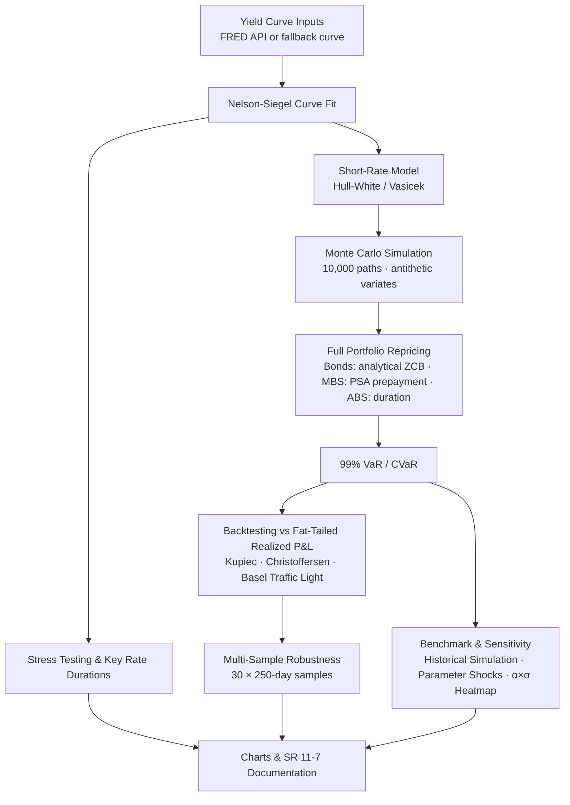

# Fixed Income Risk Analytics & Backtesting Platform

A fixed income market risk engine implementing Hull-White and Vasicek short-rate models, Monte Carlo simulation with full portfolio repricing, 99% VaR/CVaR, stress testing, key rate durations, and Basel backtesting, with auto-generated SR 11-7 model risk documentation.

---

## Project Highlights

- Hull-White (fit-to-market, Brigo-Mercurio) & Vasicek Short-Rate Models
- Nelson-Siegel Yield Curve Fitting
- Monte Carlo Simulation (10,000 Paths, Antithetic Variates)
- Full Repricing of a $97M-Notional Treasury, Corporate, MBS & ABS Portfolio
- MBS Repricing with Rate-Sensitive PSA Prepayment Model
- 99% VaR / CVaR with Historical Simulation Benchmark
- Six Stress Scenarios & 10-Tenor Key Rate Durations (KRD)
- Kupiec, Christoffersen & Basel Traffic-Light Backtesting against Fat-Tailed Realized P&L
- Multi-Sample Backtest Robustness Analysis (30 × 250-Day Samples)
- Parameter Sensitivity & α × σ VaR Heatmap
- Auto-Generated SR 11-7 Model Risk Documentation

---

## System Architecture



---

## Validation Summary

*Results use the built-in fallback yield curve (no FRED API key) with fixed random seeds, so they reproduce exactly.*

| Item | Result |
|------|--------|
| Monte Carlo paths | 10,000 (antithetic) |
| VaR confidence / horizon | 99% / 1 day |
| Kupiec POF (single 250-day sample) | PASS |
| Christoffersen CC (single 250-day sample) | PASS |
| Basel Traffic Light (single 250-day sample) | Green Zone |
| **Multi-sample exception rate (30 samples)** | **1.56% vs 1% expected** |
| Kupiec pass rate across samples | 97% |
| Basel Green rate across samples | 70% |
| Model governance | SR 11-7 documentation (draft, pending independent review) |

**Key finding:** realized rate shocks are fat-tailed (Student-t, df = 4) while the Monte Carlo engine assumes Gaussian dynamics. Across 30 independent 250-day samples the exception rate is 1.56% versus 1% expected, so the Gaussian VaR systematically underestimates tail risk. Yet Kupiec still passes in 97% of samples, showing that a single 250-day backtest has low power to detect this bias. Recommended mitigants: tail diagnostics and a fat-tailed or filtered historical simulation alternative.

---

## Charts

All charts are saved separately to `charts/`.

| Chart | Description |
|-------|-------------|
|  | Portfolio 1-day P&L distribution with VaR / CVaR |
|  | Simulated short-rate paths |
|  | Stress test P&L impact |
|  | Parameter sensitivity (ΔVaR) |
|  | Realized P&L vs 99% VaR |
|  | Key rate duration profile |
|  | Key rate DV01 (KR01) |
|  | α × σ VaR sensitivity heatmap |
|  | Exceptions across 30 backtest samples |

---

## Technology Stack

**Programming:** Python · NumPy · Pandas · SciPy · Matplotlib

**Quantitative Models:** Hull-White · Vasicek · Nelson-Siegel · Monte Carlo · PSA Prepayment

**Risk Analytics:** VaR · CVaR · Historical Simulation · Stress Testing · KRD

**Model Validation:** Kupiec · Christoffersen · Basel Traffic Light · Sensitivity Analysis · SR 11-7

---

## Repository Structure

```text
Fixed-Income-VaR-Backtesting-Engine/
├── fi_var_engine_v5.py            # full engine (single file)
├── model_risk_documentation.md    # auto-generated SR 11-7 documentation
├── charts/                        # 9 chart PNGs (generated on run)
├── README.md
└── requirements.txt
```

---

## How to Run

**Prerequisites:** Python 3.8+

```bash
pip install -r requirements.txt
python fi_var_engine_v5.py
```

`requirements.txt`:

```text
numpy
pandas
scipy
matplotlib
tabulate
```

The run prints VaR/CVaR, stress tests, KRD, backtesting, and robustness results to the console, saves all charts to `charts/`, and writes `model_risk_documentation.md`.

**Optional live yield curve:** set a FRED API key as an environment variable to pull the latest U.S. Treasury curve. Results will then change with market data.

```bash
export FRED_API_KEY="your_key_here"
```

---

## Future Enhancements

- Multi-Factor Hull-White / G2++ Model
- CIR or Shifted Log-Normal Model (non-negative rates)
- Fat-Tailed or Filtered Historical Simulation VaR
- FRTB 97.5% Expected Shortfall
- Stochastic Credit Spreads & Rate-Spread Correlation
- Parallel Monte Carlo Simulation
- Streamlit Risk Dashboard

---

## References

- Vasicek, O. (1977). An Equilibrium Characterization of the Term Structure.
- Hull, J. & White, A. (1990). Pricing Interest-Rate-Derivative Securities.
- Nelson, C. & Siegel, A. (1987). Parsimonious Modeling of Yield Curves.
- Brigo, D. & Mercurio, F. (2006). *Interest Rate Models: Theory and Practice*.
- Kupiec, P. (1995). Techniques for Verifying the Accuracy of Risk Measurement Models.
- Christoffersen, P. (1998). Evaluating Interval Forecasts.
- Basel Committee on Banking Supervision. Basel III Internal Models Approach.
- Federal Reserve SR 11-7: Supervisory Guidance on Model Risk Management.
